# RelayOps

> **RelayOps converts scattered project activity—git commits, PRs, issue tickets, chat threads, and ADR markdown docs—into a traceable, human-verified handover when a team member leaves.**
> Unlike chat assistants that hallucinate ungrounded summaries, RelayOps enforces an epistemic invariant: every claim must bind directly to verified artifact evidence, with unresolved conflicts flagged explicitly in an Ambiguity Ledger.
> Built with a bi-temporal knowledge graph, a pre-retrieval SQL clearance firewall, and dual cryptographic sign-offs, RelayOps ensures zero secrets leaked, zero unverifiable claims, and seamless Day 1–30 developer onboarding.

---

[](.github/workflows/ci.yml)
[](https://python.org)
[](https://fastapi.tiangolo.com)
[](https://react.dev)
[](https://www.typescriptlang.org)
[](https://sqlite.org)
[-indigo?style=flat-square)](docs/EVAL_REPORT.md)

---

## Visual Tour & Interface Highlights

```
+-----------------------------------------------------------------------------------------------------+
| [1] REVIEW STUDIO (Centerpiece Workbench)                                                           |
| 3 resizable panes: Outline/Filters (left), Claim Cards with Citation Pills (center),               |
| Evidence Drawer & Ambiguity Ledger (right). Inline text edits with word-level LCS diffs.           |
+-----------------------------------------------------------------------------------------------------+
| [2] DECISION TIMELINE & TOPOLOGY MAP                                                                |
| Interactive React Flow graph: SUPERSEDES chronological arrows (ADR-003 -> PR #89), red dashed       |
| UNRESOLVED conflict links, and module bus factor heatmaps (e.g., Aarav owns 85% of ledger-sync).   |
+-----------------------------------------------------------------------------------------------------+
| [3] SUCCESSOR HANDOVER PORTAL & DAY 1-30 BOARD                                                      |
| Editorial handover layout, reading acknowledgement receipts, draggable Day 1-7/8-14/15-30 tasks,   |
| and Grounded Copilot with deterministic refusal on missing evidence.                               |
+-----------------------------------------------------------------------------------------------------+
| [4] CRYPTOGRAPHIC GOVERNANCE & AUDIT LOG                                                            |
| Rolling SHA-256 hash chain verification, pre-retrieval SQL clearance firewall, and one-click       |
| tamper detection for SOC2 / ISO compliance.                                                         |
+-----------------------------------------------------------------------------------------------------+
```

*(Detailed screenshots and walk-through illustrations can be exported using `docs/DEMO_SCRIPT.md`)*.

---

## ⚡ 2-Minute Quickstart

You can run RelayOps locally using **Docker Compose** (recommended, zero setup) or directly using the **local dev environment**. Out of the box, RelayOps operates in **Replay Mode** on the bundled PayFlow dataset—**no OpenAI or Anthropic API key is required**.

### Option A: Docker Compose (Fastest)

```bash
# 1. Clone the repository
git clone https://github.com/payflow/relayops.git
cd relayops

# 2. Build and launch the container (frontend + backend bundled)
docker compose up --build -d
```

Open your browser at **[http://localhost:8000](http://localhost:8000)** (or `http://127.0.0.1:8000`). Select any demo persona from the login screen to start exploring immediately!

To stop the container:
```bash
docker compose down
```

### Option B: Local Development Setup

#### Prerequisites:
- **Python 3.11+** (Python 3.14 compatible)
- **Node.js 20+** and **npm 10+**
- Shell: `bash` (Git Bash on Windows, or macOS/Linux terminal)

```bash
# 1. Install dependencies & initialize database with demo seed
npm run setup

# 2. Launch both backend (FastAPI :8000) and frontend (Vite :5173) in dev mode
npm run dev
```

Open **[http://127.0.0.1:5173](http://127.0.0.1:5173)**. The Vite dev server proxies `/api` to FastAPI at `127.0.0.1:8000`.

---

## 👥 Demo Personas & Credentials

The seed database comes pre-loaded with the **PayFlow** project team. You can log in with a single click using the persona cards on the login page, or use the credentials below:

| Persona | Name | Email | Password | Role | Clearance | Responsibilities & Permissions |
|---|---|---|---|:---:|:---:|---|
| **Team Lead** | Meera Patel | `meera@payflow.dev` | `password123` | `lead` | 3 | Full administrative control: run pipeline, edit claims, waive ambiguities, sign off, deliver, and inspect audit logs. |
| **Outgoing Engineer** | Aarav Kulkarni | `aarav@payflow.dev` | `password123` | `outgoing` | 2 | Departing backend lead: review extracted claims, resolve ambiguities, create version snapshot, and sign off. |
| **Successor** | Kabir Sharma | `kabir@payflow.dev` | `password123` | `successor` | 1 | Incoming engineer: view verified handover, acknowledge section receipts, manage Day 1-30 board, and ask Copilot. |
| **External Contractor** | Dev Mukherjee | `dev@payflow.dev` | `password123` | `contractor` | 1 | Clearance capped at 1: confidential claims masked (`[Restricted]`), private escalation channels hidden by SQL firewall. |
| **Compliance Auditor** | Sana Chen | `sana@payflow.dev` | `password123` | `auditor` | 1 | Read-only governance access: verify rolling SHA-256 audit log hash chain and inspect readiness scorecards. |

---

## 🏗️ 5-Stage Architecture Pipeline

RelayOps enforces a linear, deterministic 5-stage transformation pipeline:

```mermaid
flowchart LR
    subgraph S1["1. CONNECT"]
        IN1["Git Commits / PRs"]
        IN2["Jira Issues"]
        IN3["Slack Threads"]
        IN4["ADR / Markdown"]
        RED["In-Memory Redaction\n(Entropy + Regex)"]
        FTS["SQLite FTS5"]
        IN1 --> RED
        IN2 --> RED
        IN3 --> RED
        IN4 --> RED
        RED --> FTS
    end

    subgraph S2["2. RECONSTRUCT"]
        ENT["Entity Resolution"]
        GRAPH["Bi-Temporal Graph"]
        AUTH["Authority Engine\n(1.0 - 0.4)"]
        CTE["Recursive CTEs\n(Deps & Ownership)"]
        FTS --> ENT
        ENT --> GRAPH
        GRAPH --> AUTH
        AUTH --> CTE
    end

    subgraph S3["3. VERIFY"]
        CITE["Citation Substring\nValidator"]
        AMB["Ambiguity Ledger\n(Conflicts & Gaps)"]
        SCORE["Readiness Scorecard\n(0 - 100)"]
        CTE --> CITE
        CITE --> AMB
        AMB --> SCORE
    end

    subgraph S4["4. REVIEW"]
        STUDIO["Review Studio Workbench\n(3-Pane Split)"]
        DIFF["Word-Level LCS Diff"]
        SNAP["Handover Snapshot\n(SHA-256)"]
        SIGN["Dual Sign-Off\n(Outgoing + Lead)"]
        SCORE --> STUDIO
        STUDIO --> DIFF
        DIFF --> SNAP
        SNAP --> SIGN
    end

    subgraph S5["5. HANDOVER"]
        PORTAL["Successor Portal\n(Editorial UI)"]
        BOARD["Day 1-30 Board\n(Draggable Tasks)"]
        COPILOT["Grounded Copilot\n(SQL Firewall Refusal)"]
        FIREWALL["Multi-Role ABAC\n(Contractor Masking)"]
        SIGN --> PORTAL
        PORTAL --> BOARD
        PORTAL --> COPILOT
        PORTAL --> FIREWALL
    end
```



### Architectural Guarantees:
1. **Zero Unverified Claims:** Every claim persisted as `verified` must bind to a real artifact with `source_uri`, `snippet`, and exact character offsets. Claims with zero evidence are rejected by the validator.
2. **Explicit Ambiguity Ledger:** When evidence is missing, conflicting, or stale, RelayOps records an explicit ambiguity rather than smoothing over gaps.
3. **Pre-Inference SQL Firewall:** Access control is enforced **in SQL before retrieval and before LLM prompting**, mathematically eliminating prompt leakage to unauthorized roles.
4. **Dual Cryptographic Sign-Off:** Handover delivery requires independent HMAC signatures from both the outgoing contributor and the lead against an identical version snapshot hash.

---

## ⚖️ Stack Justification: Architecture Decisions

Rather than adopting a complex, failure-prone enterprise stack, RelayOps implements every core capability with minimal moving parts and zero external service dependencies:

| Dossier Requirement | RelayOps Implementation | Engineering Justification |
|---|---|---|
| **PostgreSQL + pgvector + Apache AGE** | **SQLite (WAL) + FTS5 + Recursive CTEs** | Zero external service setup, single-file ACID persistence. Handover corpora comprise hundreds to thousands of artifacts. BM25 exact matching is superior to embeddings for finding exact ticket keys (`PAY-142`), commit SHAs, and PR numbers. Recursive CTEs handle multi-hop dependency tracing in microseconds. |
| **Celery + Redis Broker** | **FastAPI BackgroundTasks + `job` table + SSE** | Single-process architecture; eliminates Redis connection crashes, broker serialization bugs, and background worker drift. Real-time progress updates stream to the UI via Server-Sent Events (SSE). |
| **LangGraph / LlamaIndex / LiteLLM** | **Unified `backend/app/llm.py` Wrapper** | Fixed 5-stage DAG pipeline rather than unpredictable autonomous agents. Features JSON-schema structured output validation with Pydantic v2 and a zero-key replay cache. |
| **DeBERTa NLI Model** | **Deterministic Authority Weights + Temporal Logic** | Resolves code-vs-doc and temporal conflicts without requiring PyTorch, CUDA, or 2GB model weights. Code (1.0) beats Docs (0.6); LLM judge is invoked only on ambiguous text pairs. |
| **Presidio + TruffleHog** | **Native `backend/app/ingest/redact.py`** | High-speed Shannon entropy token detection ($> 3.2 \text{ bits/symbol}$) combined with 10+ deterministic regex patterns. Completely testable, transparent, and scrubs secrets in-memory *before* storage. |
| **Casbin ABAC Framework** | **Pure Functional `backend/app/policy.py`** | Clean Python functions evaluating role, clearance (0-3), and resource sensitivity. Table-driven, 100% unit testable, with zero external policy DSL complexity. |
| **"Cryptographic Sign-off"** | **Rolling SHA-256 Hash Chain + HMAC Signatures** | True tamper evidence: every audit log row hashes sequence $n-1$ and canonical payload JSON. Dual sign-off verifies matching SHA-256 version snapshots. |
| **Next.js 14 SSR** | **Vite + React 18 SPA served by FastAPI** | One unified container, one port, zero SSR node-server overhead for an authenticated application. |
| **React Flow** | **Retained for Decision Timeline & Topology** | Interactive, fluid visual DAG rendering for architecture dependencies and temporal supersession trees. |

---

## ⚙️ Environment Variables Reference

Copy `.env.example` to `.env` to customize runtime settings:

| Variable | Default Value | Description |
|---|---|---|
| `ENV` | `dev` | Runtime environment (`dev` or `prod`). In `prod`, the app fails fast if `SECRET_KEY` is default. |
| `DATABASE_URL` | `sqlite:///./data/relayops.db` | Database connection URL. SQLite paths are automatically anchored to `backend/`. |
| `SECRET_KEY` | `dev-only-insecure-secret...` | Cryptographic secret for JWT signing and audit HMAC validation. Must be $\ge 32$ chars in production. |
| `LLM_PROVIDER` | `replay` | LLM engine: `replay` (zero-key offline mode), `openai_compatible` (free tiers), `anthropic`, or `openai`. |
| `LLM_MODEL` | *(provider default)* | Model identifier. Blank uses the provider default (`openai_compatible` → `openai/gpt-oss-120b`). |
| `LLM_BASE_URL` | *(empty)* | OpenAI-compatible endpoint for `openai_compatible`, e.g. `https://api.groq.com/openai/v1`. |
| `LLM_API_KEY` | *(empty)* | Key for that endpoint (free, no credit card: Groq or Google AI Studio). |
| `ANTHROPIC_API_KEY` | *(empty)* | Optional paid Anthropic API key for live mode. |
| `OPENAI_API_KEY` | *(empty)* | Optional paid OpenAI API key for live mode. |
| `GITHUB_TOKEN` | *(empty)* | Optional GitHub Personal Access Token to avoid rate limits during real repo ingestion. |
| `CORS_ORIGINS` | `http://localhost:5173,...` | Comma-separated list of allowed browser origins. |
| `MAX_UPLOAD_MB` | `20` | Maximum file upload size for JSON archives and Markdown files. |
| `PORT` | `8000` | Application server port. |
| `SEED_ON_START` | `true` | When `true`, automatically seeds demo accounts and PayFlow dataset if the DB is empty. |

---

## 📂 Repository Tour

```
relayops-ai/
├── backend/
│   ├── app/
│   │   ├── main.py              # FastAPI app lifecycle, SPA static mounting, error handlers
│   │   ├── config.py            # Pydantic-settings, prod fail-fast validations
│   │   ├── db.py                # SQLite WAL connection, FTS5 sync triggers, rolling audit chain
│   │   ├── models.py            # SQLModel schema (ULID PKs, bi-temporal node/edge, claims)
│   │   ├── auth.py              # scrypt password hashing, JWT cookie authentication
│   │   ├── policy.py            # ABAC access rules, effective clearance, claim masking
│   │   ├── llm.py               # Unified LLM provider (replay cache, Anthropic, OpenAI)
│   │   ├── jobs.py              # Background job execution runner & SSE logger
│   │   ├── eval.py              # 10-scenario ground-truth evaluation benchmark
│   │   ├── ingest/              # CONNECT: Loaders, GitHub API, Slack/Jira JSON, redaction
│   │   ├── reconstruct/         # RECONSTRUCT: Entity resolver, bi-temporal graph, authority weights
│   │   ├── verify/              # VERIFY: Citation validator, conflict engine, scorecard
│   │   ├── handover/            # REVIEW & HANDOVER: Claims, snapshots, dual sign-off, Copilot
│   │   └── routers/             # REST endpoints (/api/v1/{auth,projects,sources,handovers,etc.})
│   ├── seed/                    # Synthetic generator, PayFlow dataset, ground_truth.json, recordings
│   └── tests/                   # Pytest suite (173 backend tests + golden path integration)
├── frontend/
│   ├── src/
│   │   ├── app/                 # Router, theme provider, auth context
│   │   ├── components/          # UI primitives (shadcn), CitationPills, WordDiff, Drawers
│   │   ├── pages/               # Dashboard, Projects, ReviewStudio, Portal, Timeline, Governance
│   │   └── lib/                 # TanStack Query API hooks, formatters, graph layouts
│   └── package.json             # React 18, Tailwind v3, Vite 5, React Flow
├── docs/                        # Complete technical specifications & reports
│   ├── ARCHITECTURE.md          # Data model ERD, bi-temporal semantics, CTE traversal
│   ├── POLICY.md                # ABAC matrix, clearance caps, firewall specification
│   ├── SCORING.md               # 0-100 readiness scorecard mathematical formula
│   ├── SECURITY.md              # Threat model: prompt injection, secret leakage, tampering
│   ├── EVAL_REPORT.md           # Benchmark results against ground truth (100% pass)
│   ├── DEMO_SCRIPT.md           # 5-minute minute-by-minute judge demo script
│   ├── DEPLOYMENT.md            # Production deployment (Docker, Compose, Render, Fly.io)
│   └── LIMITATIONS.md           # Honest engineering limitations and production roadmap
├── e2e/                         # Playwright end-to-end browser test suites
├── scripts/                     # Cross-platform bash helper scripts (dev, test, build, smoke)
├── Dockerfile                   # Multi-stage production container (Node 20 -> Python 3.11)
├── docker-compose.yml           # Single-command local deployment with persistent disk
└── Makefile                     # Documented interface delegating to scripts/
```

---

## 🔄 Replay Mode vs. Live LLM Operation

RelayOps is built to demo and evaluate flawlessly without requiring third-party API keys or internet access.

### How Replay Mode Works
When `LLM_PROVIDER=replay` (the default) or when API keys are omitted, `backend/app/llm.py` intercepts calls and serves recorded model responses from `backend/seed/llm_recordings.json`.
- **100% Deterministic:** Every extraction, summary, and verification produces reproducible results.
- **Zero Cost & Zero Network:** Perfect for CI pipelines, air-gapped demo environments, and hackathon evaluation.
- **Ground Truth Grounding:** Recorded outputs reflect the exact 10 ground-truth scenarios in `backend/seed/ground_truth.json`.

### How to Run Live for Free (no credit card)
RelayOps talks to any OpenAI-compatible endpoint, so a free tier is enough. **Groq** is the recommended default — `openai/gpt-oss-120b` supports strict JSON-schema output and the free plan allows ~30 requests/minute and 1,000 requests/day with no card:
```bash
# In your .env file:
LLM_PROVIDER=openai_compatible
LLM_BASE_URL=https://api.groq.com/openai/v1
LLM_MODEL=openai/gpt-oss-120b
LLM_API_KEY=gsk_...            # https://console.groq.com/keys
```
**Google AI Studio (Gemini free tier)** works through the same code path:
```bash
LLM_PROVIDER=openai_compatible
LLM_BASE_URL=https://generativelanguage.googleapis.com/v1beta/openai/
LLM_MODEL=gemini-3.8-flash
LLM_API_KEY=...                # https://aistudio.google.com/apikey
```
Paid providers still work unchanged (`LLM_PROVIDER=openai|anthropic` with `OPENAI_API_KEY` / `ANTHROPIC_API_KEY`). Restart the server (or restart `npm run dev`). All pipeline stages and the Handover Copilot will now invoke the live model with Pydantic JSON-schema structured output validation; when a host rejects `json_schema`, the client automatically retries with `strict: false`, then with a plain `json_object` plus the schema in the prompt.

---

## 🧪 Testing, Quality & Evaluation

RelayOps features a comprehensive test suite across backend unit, integration, frontend unit, and browser E2E tests:

```bash
# 1. Run all backend tests (173 tests: auth, policy, redaction, graph, golden path)
npm run test
# or: pytest backend/tests

# 2. Run the ground-truth benchmark evaluation (generates docs/EVAL_REPORT.md)
npm run eval
# or: python -m app.eval

# 3. Run frontend unit tests (Vitest: CitationPills, LCS diff, masking)
npm run test:frontend

# 4. Verify TypeScript strict type-checking & frontend production build
npm run typecheck
npm run build

# 5. Run end-to-end browser tests (Playwright)
npm run test:e2e

# 6. Execute deployment smoke test against running instance
npm run smoke
```

### Benchmark Results Summary (`docs/EVAL_REPORT.md`):
- **Scenario Recall:** 10/10 (100.0%) ground-truth scenarios detected.
- **Planted Secret Recall:** 100.0% of planted fake credentials scrubbed prior to storage.
- **Hallucination Rate:** 0.0% (zero claims without valid evidence persisted as verified).
- **Evidence Link Validity:** 100.0% of citations verified via character-level substring matching.
- **Firewall Isolation:** 100.0% of confidential strings prevented from reaching unauthorized roles.

---

## 🛡️ License

RelayOps is licensed under the [Apache 2.0 License](LICENSE). Built with pride for high-integrity engineering teams.
