# RelayOps Architecture Specification

RelayOps transforms messy, multi-source developer activity (git commits, pull requests, issue trackers, chat channels, and ADR/RFC documents) into an evidence-linked, human-verified handover blueprint.

Unlike typical conversational AI systems, RelayOps is **not a chatbot**. It is an epistemic verification pipeline designed around deterministic constraints:
1. **Zero Hallucination Tolerance:** Every claim shown to a successor must bind to an immutable artifact snippet.
2. **Pre-Inference Authorization:** Permission boundaries are enforced before retrieval and before LLM prompting, not by masking text after generation.
3. **Explicit Ambiguity:** Gaps, conflicting claims, and orphan branches are captured in an **Ambiguity Ledger** rather than smoothed over.
4. **Dual Cryptographic Sign-Off:** Handover delivery requires independent HMAC cryptographic signatures from both the outgoing engineer and the team lead on an identical version snapshot hash.

---

## 1. 5-Stage Pipeline Architecture

The end-to-end knowledge transformation process executes as a directed five-stage pipeline:

```mermaid
flowchart LR
    subgraph S1["1. CONNECT"]
        GH["GitHub API / PRs"]
        JIRA["Jira JSON"]
        SLACK["Slack Threads"]
        DOCS["ADR / RFC Docs"]
        RED["In-Memory Redaction\n(Entropy + Regex)"]
        FTS["SQLite FTS5 Storage"]
        GH --> RED
        JIRA --> RED
        SLACK --> RED
        DOCS --> RED
        RED --> FTS
    end

    subgraph S2["2. RECONSTRUCT"]
        ENT["Entity Resolution\n(Aliases & Identities)"]
        GRAPH["Bi-Temporal Graph\n(Nodes & Edges)"]
        AUTH["Authority Engine\n(Weights 1.0 - 0.4)"]
        CTE["Recursive CTEs\n(Ownership & Deps)"]
        FTS --> ENT
        ENT --> GRAPH
        GRAPH --> AUTH
        AUTH --> CTE
    end

    subgraph S3["3. VERIFY"]
        CITE["Citation Substring\nValidator"]
        AMB["Ambiguity Ledger\n(Conflicts & Gaps)"]
        SCORE["Readiness Scorecard\n(0 - 100 Formula)"]
        CTE --> CITE
        CITE --> AMB
        AMB --> SCORE
    end

    subgraph S4["4. REVIEW"]
        STUDIO["Review Studio Workbench\n(3-Pane Split Screen)"]
        DIFF["Word-Level LCS Diff"]
        SNAP["Handover Snapshot\n(SHA-256 Hash)"]
        SIGN["Dual Sign-Off\n(Outgoing + Lead)"]
        SCORE --> STUDIO
        STUDIO --> DIFF
        DIFF --> SNAP
        SNAP --> SIGN
    end

    subgraph S5["5. HANDOVER"]
        PORTAL["Successor Portal\n(Editorial View)"]
        BOARD["Day 1-30 Board\n(Draggable Tasks)"]
        COPILOT["Grounded Copilot\n(SQL Firewall Refusal)"]
        FIREWALL["Multi-Role ABAC\n(Contractor Masking)"]
        SIGN --> PORTAL
        PORTAL --> BOARD
        PORTAL --> COPILOT
        PORTAL --> FIREWALL
    end
```



### Stage Details

| Stage | Responsibility | Invariants & Guarantees |
|---|---|---|
| **CONNECT** | Ingest raw JSON/Markdown/API payloads via unified `Loader` protocols. Normalize dates and author identities. | 100% of planted secrets, tokens, connection strings, and PII are scrubbed **in-memory prior to persistence** and prior to LLM calls. Idempotent re-ingestion via `UNIQUE(project_id, kind, external_id)`. |
| **RECONSTRUCT** | Resolve persona aliases across tools (`akulkarni`, `aarav-dev`, `Aarav Kulkarni`). Construct bi-temporal nodes and edges. Compute module ownership based on git blame commit share ($\ge 60\%$). | Every node and edge tracks valid time (when it occurred) and transaction time (when ingested). Recursive CTEs evaluate multi-hop module dependencies and bus factor risks. |
| **VERIFY** | Extract candidate handover claims. Bind every claim to exact character substrings in source artifacts. Detect chronological supersessions and open contradictions. | Zero claims without evidence links persist as verified. Contemporaneous disagreements between equal-authority sources are flagged as `UNRESOLVED` in the Ambiguity Ledger. |
| **REVIEW** | Human-in-the-loop (HITL) workbench. Engineers accept, edit, or reject claims; resolve or waive ambiguities; and trigger version snapshots. | Editing an accepted claim records a word-level diff and resets dependent approvals. Freezing a version snapshot computes a canonical SHA-256 hash. |
| **HANDOVER** | Deliver role-tailored onboarding portals (Maintainer, Junior, Contractor, Auditor), Day 1-30 execution boards, and grounded Q&A Copilot. | SQL clearance firewall prevents unauthorized tokens from ever reaching LLM context. Successor acknowledges sections via receipt tracking. |

---

## 2. Data Model & Entity-Relationship Diagram (ERD)

RelayOps models all domain entities using SQLModel (SQLAlchemy + Pydantic v2) backed by SQLite with write-ahead logging (WAL) and foreign keys enabled. All primary keys (except autoincrementing audit logs) are 26-character time-sortable **ULID** strings.

```mermaid
erDiagram
    PROJECT ||--o{ PROJECT_MEMBER : has
    USER ||--o{ PROJECT_MEMBER : participates
    PROJECT ||--o{ SOURCE : configures
    SOURCE ||--o{ ARTIFACT : ingests
    ARTIFACT ||--o{ REDACTION_EVENT : audits
    PROJECT ||--o{ ENTITY : resolves
    PROJECT ||--o{ NODE : builds
    NODE ||--o{ EDGE : connects_src
    NODE ||--o{ EDGE : connects_dst
    PROJECT ||--o{ HANDOVER : organizes
    USER ||--o{ HANDOVER : outgoing
    USER ||--o{ HANDOVER : successor
    USER ||--o{ HANDOVER : lead
    HANDOVER ||--o{ CLAIM : generates
    HANDOVER ||--o{ AMBIGUITY : flags
    HANDOVER ||--o{ HANDOVER_VERSION : freezes
    HANDOVER ||--o{ SIGNOFF : authenticates
    HANDOVER ||--o{ PLAN_ITEM : plans
    HANDOVER ||--o{ RECEIPT : tracks
    HANDOVER ||--o{ CHAT_SESSION : hosts
    CHAT_SESSION ||--o{ CHAT_MESSAGE : exchanges
    PROJECT ||--o{ JOB : runs
    USER ||--o{ AUDIT_LOG : actions

    USER {
        string id PK "ULID"
        string email UK
        string name
        string password_hash "scrypt"
        string role "lead | outgoing | successor | contractor | auditor"
        int clearance "0: Public, 1: Internal, 2: Confidential, 3: Restricted"
        bool is_active
        datetime created_at
        datetime updated_at
    }

    PROJECT {
        string id PK "ULID"
        string name
        string slug UK
        string description
        string repo_url
        string status "active | archived"
        datetime created_at
        datetime updated_at
    }

    ARTIFACT {
        string id PK "ULID"
        string project_id FK
        string source_id FK
        string kind "commit | pull_request | issue | chat_thread | adr_doc | runbook"
        string external_id "e.g. PAY-142, PR #89, sha"
        string source_uri
        string title
        string body_redacted
        string body_hash "sha256"
        string author_alias
        string author_entity_id FK
        datetime valid_time "World time"
        datetime transaction_time "Ingest time"
        int sensitivity "0 - 3"
        json acl_tags
        float authority "0.4 - 1.0"
        json meta
        int redaction_count
    }

    NODE {
        string id PK "ULID"
        string project_id FK
        string type "decision | blocker | module | person | commit | pr | issue | doc"
        string key
        string label
        json props
        datetime valid_from
        datetime valid_to
        datetime tx_from
        datetime tx_to
        float authority
        string artifact_id FK
    }

    EDGE {
        string id PK "ULID"
        string project_id FK
        string src_node_id FK
        string dst_node_id FK
        string type "SUPERSEDES | BLOCKS | OWNS | CONTRADICTS | DEPENDS_ON | REFERENCES | AUTHORED"
        datetime valid_from
        datetime valid_to
        float confidence
        json evidence
    }

    HANDOVER {
        string id PK "ULID"
        string project_id FK
        string outgoing_user_id FK
        string successor_user_id FK
        string lead_user_id FK
        string status "draft | reconstructing | in_review | signed | delivered"
        int current_version
        datetime due_date
        string notes
    }

    CLAIM {
        string id PK "ULID"
        string project_id FK
        string handover_id FK
        string section "Architecture | Ownership | Blockers | Runbooks | etc."
        string kind "architecture_decision | ownership | blocker | risk | dependency"
        string text
        string status "draft | accepted | edited | rejected | needs_review"
        float confidence "0.0 - 1.0"
        int sensitivity "0 - 3"
        json evidence "List of {artifact_id, source_uri, snippet, char_start, char_end}"
        string origin "llm | rule | human"
        string edited_by
        string rejected_reason
        int order_index
        string parent_claim_id FK
    }

    AMBIGUITY {
        string id PK "ULID"
        string project_id FK
        string handover_id FK
        string type "orphan_branch | conflict | undocumented_module | unclosed_thread | stale_config"
        string severity "high | med | low"
        string title
        string description
        json artifact_ids
        string status "open | resolved | waived"
        string resolution_note
        string resolved_by
    }

    HANDOVER_VERSION {
        string id PK "ULID"
        string handover_id FK
        int version
        json snapshot "Full canonical JSON snapshot of claims and ambiguities"
        string prev_hash "SHA-256 rolling hash"
        string hash "SHA-256 canonical hash"
        string created_by
        string reason
    }

    SIGNOFF {
        string id PK "ULID"
        string handover_id FK
        int version
        string user_id FK
        string role "outgoing | lead"
        string signature "HMAC-SHA256 signature"
        datetime signed_at
        string comment
    }

    AUDIT_LOG {
        int seq PK "Autoincrement"
        string actor_id
        string action "e.g. redact, claim_edit, signoff, copilot_query"
        string target_type
        string target_id
        json payload
        string prev_hash "Rolling SHA-256"
        string hash "SHA-256(prev_hash + canonical_json)"
        datetime created_at
    }
```



---

## 3. Bi-Temporal Knowledge Graph & Resolution Semantics

RelayOps separates **valid time** (the time an event, commit, decision, or message occurred in reality) from **transaction time** (the time RelayOps ingested or learned about the record).

### Temporal Model Attributes
- **Nodes & Artifacts**:
  - `valid_from` / `valid_time`: ISO-8601 UTC timestamp of original activity.
  - `valid_to`: Timestamp when a decision or ownership was superseded or invalidated (`NULL` indicates actively current).
  - `tx_from` / `transaction_time`: Ingestion timestamp into the RelayOps database.
  - `tx_to`: Timestamp when an ingestion record was modified or soft-deleted.

### Source Authority Hierarchy
Not all evidence carries equal epistemic weight. RelayOps assigns deterministic authority scores:

| Source Artifact Type | Authority Weight | Epistemic Justification |
|---|:---:|---|
| **Production Code / Merged PR** | `1.0` | Ground truth of running software. Merged commits override discussions. |
| **Issue Tracker (Jira / GitHub Issues)** | `0.8` | Structured institutional intent and accepted tracking. |
| **Architecture Decision Records (ADRs) / Runbooks** | `0.6` | Formal design documentation; may decay if not kept synchronized. |
| **Unmerged Branches / Closed PRs** | `0.5` | In-flight or abandoned work; indicates WIP or orphan branches. |
| **Chat Threads (Slack / Discord)** | `0.4` | Informal conversational chatter, ephemeral context, brainstorming. |

### Temporal Authority Resolution Algorithm

When two pieces of evidence discuss the same subject or make conflicting claims, RelayOps applies a deterministic 4-case resolution rule implemented in `backend/app/reconstruct/authority.py`:

```
                                [Claim A vs Claim B]
                                         |
                       Are claims within 24h of each other?
                                /                 \
                             YES                   NO
                             /                       \
             [Contemporaneous Check]           [Sequential Ordering]
             /                     \                      |
   Equal Authority?          Unequal Authority?     Newer has >= Authority?
       /         \                 |                   /                \
     YES          NO        Higher Authority         YES                 NO
      |            |         Wins with Warning        |                   |
 [UNRESOLVED]  [CONFLICT]           |            [SUPERSEDES]        [CONFLICT]
 Human Review  Flagged for      [CONFLICT]      Older marked        Newer chat cannot
  Mandatory      Review         Needs Review     invalidated         override older code
```

#### Real Scenario Examples from Seed Data:
1. **ADR-003 vs PR #89 (Session Management):**
   - *Oct 12:* ADR-003 (authority `0.6`) proposes Redis server-side session caching.
   - *Nov 02:* PR #89 (authority `1.0`) merges stateless JWT authentication to avoid Redis operational overhead.
   - *Resolution:* Newer + Higher Authority $\rightarrow$ **`SUPERSEDES`**. Node `ADR-003` receives `valid_to = 2026-11-02T14:30:00Z`. In the UI timeline, the Redis decision is struck through with an arrow to PR #89.
2. **Payment Rate Limit Slack Thread:**
   - *Nov 04 10:15 UTC:* Engineer 1 states payment provider rate limit is `100 req/min`.
   - *Nov 04 11:30 UTC:* Engineer 2 states rate limit was increased to `500 req/min`.
   - *Context:* Both sources are chat messages (authority `0.4`), occurred within 24 hours, and no code commit exists specifying the limit.
   - *Resolution:* Contemporaneous + Equal Authority $\rightarrow$ **`UNRESOLVED CONFLICT`**. Tracked as high-severity item in the Ambiguity Ledger.
3. **Webhook Retry Limit (Doc vs Code):**
   - `runbook-webhooks.md` (authority `0.6`) claims webhook retries max out at 3 attempts.
   - `src/payflow/webhook/retry.py` (authority `1.0`) specifies `MAX_RETRIES = 5`.
   - *Resolution:* Code wins on authority, but doc contradiction flags an ambiguity for the outgoing engineer to reconcile.

---

## 4. Graph Traversal via Recursive Common Table Expressions (CTEs)

Rather than introducing heavy external graph databases (Neo4j, Apache AGE), RelayOps leverages SQLite recursive CTEs for fast, transactional graph algorithms directly over the `node` and `edge` tables.

### Module Dependency CTE
Traces deep downstream and upstream architectural dependencies up to $N$ hops:

```sql
WITH RECURSIVE dependency_tree(node_id, depth, path) AS (
    -- Anchor: direct dependencies of target module
    SELECT dst_node_id, 1, src_node_id || '->' || dst_node_id
    FROM edge
    WHERE src_node_id = :start_module_id
      AND type = 'DEPENDS_ON'
      AND (valid_to IS NULL OR valid_to > CURRENT_TIMESTAMP)
    
    UNION ALL
    
    -- Recursive member: traverse downstream edges
    SELECT e.dst_node_id, dt.depth + 1, dt.path || '->' || e.dst_node_id
    FROM edge e
    JOIN dependency_tree dt ON e.src_node_id = dt.node_id
    WHERE e.type = 'DEPENDS_ON'
      AND (e.valid_to IS NULL OR e.valid_to > CURRENT_TIMESTAMP)
      AND dt.depth < 10
      AND dt.path NOT LIKE '%' || e.dst_node_id || '%' -- Cycle detection
)
SELECT DISTINCT n.id, n.key, n.label, dt.depth
FROM dependency_tree dt
JOIN node n ON dt.node_id = n.id
ORDER BY dt.depth ASC;
```

### Module Ownership & Bus Factor Analysis
Calculated by aggregating commit share over author entities:
- If a single contributor authored $\ge 60\%$ of commits touching a module, they are assigned primary ownership: `(Author)-[OWNS]->(Module)`.
- If no single author reaches 60%, ownership is classified as `shared`.
- Any module with $\ge 3$ commits where the departing engineer is the sole owner ($100\%$ author share) triggers an automatic `undocumented_module` bus-factor risk in the Ambiguity Ledger.

---

## 5. Pre-Inference SQL Clearance Firewall

RelayOps enforces a fundamental security invariant: **Access control is applied BEFORE retrieval and BEFORE prompting the LLM, never by redacting model outputs after the fact.**

### Why Post-Hoc Masking Fails
In traditional RAG systems, all documents matching a semantic query are placed into the LLM context prompt. If an unauthorized user asks a probing question, the LLM may leak confidential information through summarization, nuance, or jailbreaking, even if filters attempt to censor the final output.

### The RelayOps Architecture
1. The user's role and identity determine their **`effective_clearance`** (0 to 3).
2. All retrieval queries—whether via FTS5 full-text search or direct entity lookups—inject `sensitivity <= :effective_clearance` into the SQL `WHERE` clause.
3. High-sensitivity artifacts (e.g. private Slack channels discussing partner disputes or salaries) never return from the database.
4. The LLM context prompt contains **zero tokens** of unauthorized text. It is physically impossible for the model to leak what it never received.

```sql
-- Enforced in backend/app/db.py: search_artifacts()
SELECT a.id, a.project_id, a.kind, a.external_id, a.source_uri,
       a.title, a.body_redacted, a.sensitivity, a.authority
FROM artifact_fts f
JOIN artifact a ON a.rowid = f.rowid
WHERE artifact_fts MATCH :search_query
  AND a.project_id = :project_id
  AND a.sensitivity <= :effective_clearance
ORDER BY f.rank
LIMIT :limit;
```

---

## 6. Cryptographic Integrity: Hash Chains & Dual Sign-Off

To guarantee that handover records cannot be tampered with or modified after sign-off, RelayOps implements two cryptographic safeguards:

### 1. Rolling SHA-256 Audit Chain
Every sensitive operation (secret redaction, claim modification, ambiguity resolution, snapshot generation, copilot query) appends a record to the `audit_log` table. Each row includes:
- `seq`: Monotonically increasing sequence integer.
- `prev_hash`: SHA-256 hash of sequence $seq - 1$.
- `hash`: $\operatorname{SHA-256}(\text{prev\_hash} \,\|\, \text{canonical\_json}(\text{actor\_id}, \text{action}, \text{target\_type}, \text{target\_id}, \text{payload}))$.

The auditor endpoint (`GET /api/v1/governance/audit/verify`) traverses all rows from sequence 1 to $N$, re-computing every hash. Any bit-flip, deleted row, or unauthorized manual database edit immediately breaks the chain and reports the exact sequence number where tampering occurred.

### 2. Dual Sign-Off on Frozen Snapshots
A handover cannot transition to `delivered` status until:
1. A **`HandoverVersion`** snapshot is created, freezing the entire claim graph and ambiguity status into an immutable JSON blob with a canonical SHA-256 hash.
2. The **Outgoing Contributor** reviews and submits an HMAC-SHA256 signature referencing this exact version number and hash.
3. The **Team Lead** independently reviews and submits their HMAC-SHA256 signature referencing the exact same version number and hash.
4. Any subsequent edit to a claim automatically increments the version draft, invalidates all existing signatures, and resets the sign-off state machine.
